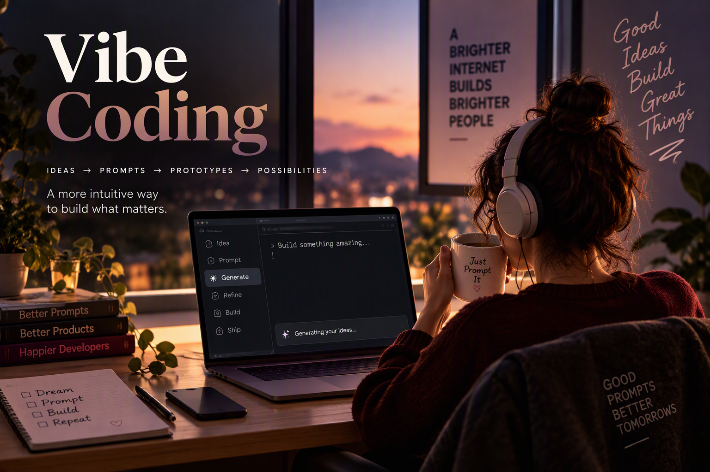

<a href="README.en.md"><button>English</button><a>

# Todos os Projetos de Vibe Coding da Danielli Ayumi

## Coleção de Projetos Vibe Coded

Esta coleção reúne projetos desenvolvidos utilizando práticas de Vibe Coding como ferramenta de prototipação, validação de ideias e exploração de soluções digitais para problemas reais. Os projetos abrangem diferentes áreas, incluindo recrutamento, finanças pessoais, turismo e delivery, demonstrando como a colaboração entre inteligência artificial e engenharia de software pode acelerar a transformação de conceitos em protótipos funcionais. Cada aplicação foi concebida para validar requisitos, fluxos de usuário e oportunidades de mercado, mantendo o foco na experiência do usuário, na organização de informações e na resolução prática de desafios do cotidiano.

| Nome do App | Breve Descrição | README do Projeto | Testar Aplicação |
|------------|----------------|------------------|------------------|
| Grounded | Grounded é uma plataforma que analisa a compatibilidade com ATS, otimiza currículos e ajuda candidatos a rastrear e organizar suas candidaturas de forma mais eficiente. | [README do Grounded](https://github.com/dani-ayumi-dev/Grounded-App-ATS-friendly-CV-Analyzer-with-Lovable) |
| FinBuddy | FinBuddy ajuda jovens adultos a controlar e monitorar suas decisões financeiras com base em dados reais, utilizando 4 chatbots com personalidades distintas que se conectam à forma de pensar da geração mais jovem. | [README do FinBuddy](https://github.com/dani-ayumi-dev/FinBuddy-Finances-App-Vibe-Coding) | [FinBuddy](https://grouded.lovable.app/) |
| Travelo | Travelo é uma plataforma digital projetada para mulheres que desejam viajar sozinhas com mais segurança, autonomia e organização. | [README do Travelo](https://github.com/dani-ayumi-dev/Travelo-Vibe-Coded-app-for-Solo-Female-Travelers-with-Lovable) | [Travelo](https://travelowithdyonna.lovable.app/) |
| Deliverrr | Deliverrr é uma plataforma de delivery construída utilizando princípios de Vibe Coding, focada em oferecer uma experiência moderna tanto para clientes quanto para proprietários de restaurantes. | [README do Deliverrr](https://github.com/dani-ayumi-dev/Deliverrr-Vibe-Coded-Delivery-app-using-Lovable/blob/main/README.md) | Indisponível |